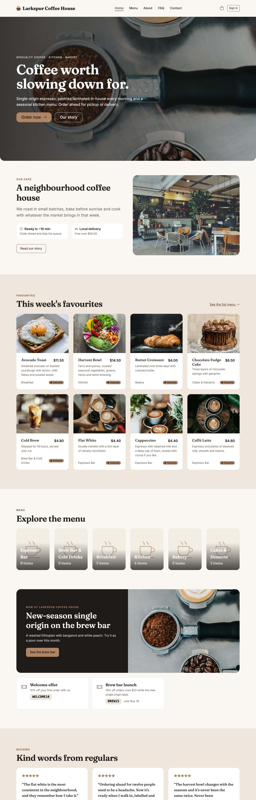
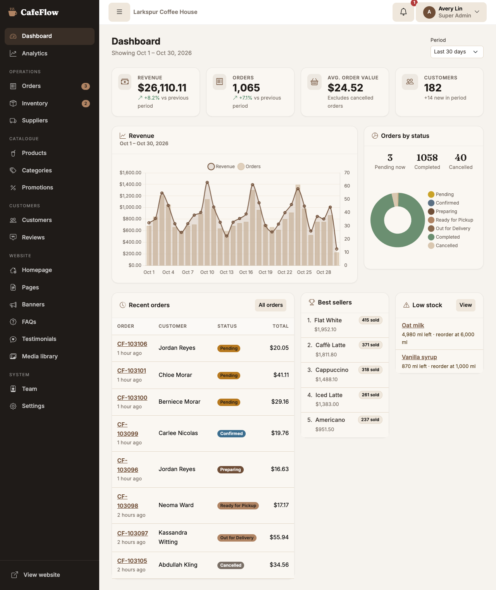
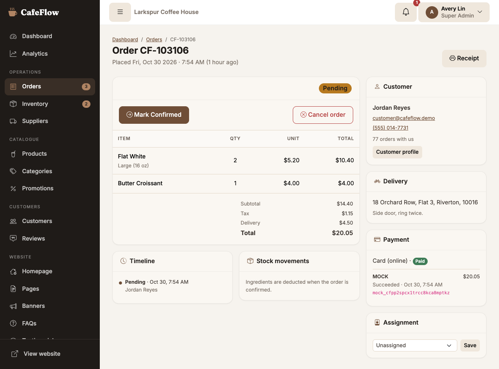
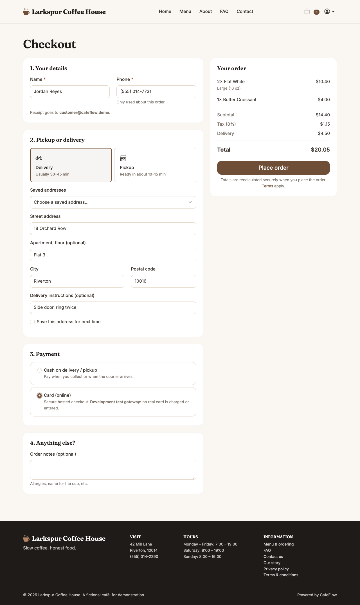
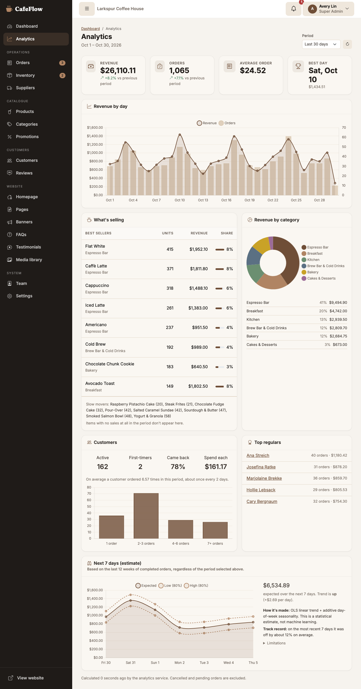
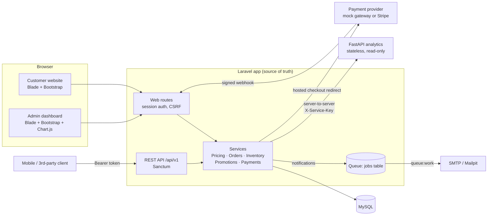
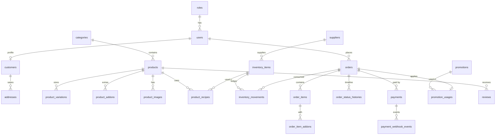

# CafeFlow

Ordering and back-office software for a single café or small restaurant: a customer website (menu, cart, checkout, order tracking), an admin dashboard for the team, a small CMS, and a separate Python service for sales analytics and forecasting.

The demo data is for **Larkspur Coffee House**, a fictional café in the fictional town of Riverton. Names, addresses, phone numbers (all `555-01xx`) and reviews are invented.



| | |
|---|---|
|  |  |
|  |  |

More screenshots, including mobile, are in [`docs/screenshots/`](docs/screenshots).

---

## Contents

- [Stack](#stack)
- [Quick start (Docker)](#quick-start-docker)
- [Demo accounts](#demo-accounts)
- [Architecture](#architecture)
- [Database design](#database-design)
- [Roles and permissions](#roles-and-permissions)
- [Orders, stock and payments](#orders-stock-and-payments)
- [Email and queues](#email-and-queues)
- [REST API](#rest-api)
- [Analytics service](#analytics-service)
- [Tests](#tests)
- [Configuration reference](#configuration-reference)
- [Deploying to production](#deploying-to-production)
- [Known limitations](#known-limitations)

---

## Stack

| Part | Technology |
|---|---|
| Web app and API | Laravel 13, PHP 8.4, Blade, Bootstrap 5 (Sass), a little vanilla JS, Chart.js |
| Database | MySQL 8.4 |
| Auth | Session auth for the website, Laravel Sanctum bearer tokens for the API |
| Queue | Laravel database queue (`queue:work`) |
| Analytics | Python 3.11+, FastAPI, Pydantic, pandas/NumPy (`services/analytics/`) |
| Local mail | Mailpit |
| Assets | Vite |

React and Vue are not used anywhere.

## Quick start (Docker)

Requirements: Docker Desktop (or another Docker engine with Compose v2) and Node 20+ to build the front-end assets.

```bash
cp .env.example .env
cp services/analytics/.env.example services/analytics/.env
```

In `.env`, set your own values for:

- `DB_PASSWORD` and `DB_ROOT_PASSWORD`, any local passwords.
- `ANALYTICS_SERVICE_KEY`. Generate one with `openssl rand -hex 32` and use **the same value** for `ANALYTICS_SERVICE_KEY` in `services/analytics/.env`.
- `MOCK_PAYMENT_WEBHOOK_SECRET`. Generate one with `openssl rand -hex 32`.

Then:

```bash
docker compose up -d --build
docker compose exec app composer install
docker compose exec app php artisan key:generate
docker compose exec app php artisan migrate --seed
docker compose exec app php artisan storage:link
npm install && npm run build
```

| URL | What |
|---|---|
| http://localhost:8000 | Customer website |
| http://localhost:8000/admin | Admin dashboard |
| http://localhost:8000/docs/api | API reference (Swagger UI) |
| http://localhost:8025 | Mailpit: every email the app sends locally |
| http://localhost:8001/health | Analytics service health check |

The compose file starts five services: `app` (`php artisan serve`), `queue` (`php artisan queue:work`), `mysql`, `analytics` and `mailpit`. The MySQL container also creates a separate `cafeflow_testing` database for the test suite (`docker/mysql/`).

For front-end work, run `npm run dev` instead of `npm run build` to get hot reloading.

### Without Docker

Install PHP 8.3+ (with `pdo_mysql`, `intl`, `gd`, `bcmath`), Composer, MySQL 8 and Python 3.11+, then point `DB_HOST` and `MAIL_HOST` at your own services. Start the app with `php artisan serve` and `php artisan queue:work`, and the analytics service as described in [`services/analytics/README.md`](services/analytics/README.md).

## Demo accounts

`php artisan migrate --seed` creates these accounts **only when `APP_ENV` is not `production`**. In production the demo seeders are skipped, and the user seeder throws if it is ever called directly.

| Role | Email | Password |
|---|---|---|
| Super Admin | `admin@cafeflow.demo` | `CafeFlow!2026` |
| Manager | `manager@cafeflow.demo` | `CafeFlow!2026` |
| Staff | `staff@cafeflow.demo` | `CafeFlow!2026` |
| Customer | `customer@cafeflow.demo` | `CafeFlow!2026` |

The password is a development default (`CAFEFLOW_DEMO_PASSWORD`), so change it if your machine is shared.

The seed data, all generated locally:

- 6 categories and 32 products: 31 live, 1 draft. Most products have sizes and add-ons.
- 37 inventory items with recipes. Oat milk and vanilla syrup start below their reorder level, so the low-stock warnings have something to show.
- 5 suppliers and 5 promotion codes: `WELCOME10`, `MORNING2`, `BREW15`, `SUMMER5`, `STAFFTEST`.
- About 180 customers and 90 days of order history (~3,100 orders), with stock consumption recorded.
- Today's orders are placed through the real order service, so they are in every status.
- Reviews, FAQs, testimonials, banners, and the About, Privacy and Terms pages.

## Architecture



Key decisions:

- **Laravel owns every business record.** The Python service has no database connection. Laravel sends it the order rows it needs for a report, and it returns computed figures. It cannot create, change or delete anything in Laravel.
- **The analytics key stays on the server.** The browser and API clients only talk to Laravel. Laravel calls Python with `X-Service-Key` and proxies the result back through its own auth (`/api/v1/analytics/*` needs the `view-analytics` permission).
- **Analytics can fail without breaking anything.** Calls have a 2 s connect timeout, a 5 s total timeout and retries for network errors and 5xx responses only. Results are cached for 5 minutes. If the service is down, the dashboard shows a notice and sales totals computed directly in MySQL.
- **Business rules live in services** (`app/Services`). Web controllers and API controllers call the same `OrderService`, `PricingService`, `InventoryService` and `PromotionService`, so the rules can't drift apart.
- **Money is handled in integer cents** inside the services (`App\Support\Money`) and stored as `DECIMAL(10,2)`.

## Database design

36 tables. The important ones:



Notes:

- **Order lines are snapshots.** `order_items` stores the product name, size name, unit price and recipe multiplier at the time of the order. Later edits to the menu never change a past receipt.
- **Stock is a ledger.** `inventory_items.quantity` is the running balance. Every change (restock, waste, count adjustment, order consumption, reversal) writes an `inventory_movements` row with the change and the balance after it, plus who made it and why.
- **Webhooks are idempotent.** `payment_webhook_events (provider, event_id)` is unique, so a redelivered event is detected and acknowledged without being processed twice.
- **Soft deletes** are used for products, categories, inventory items, suppliers, promotions and users, so history stays intact.
- **Indexes** follow the real queries: orders by `(status, placed_at)`, `(user_id, placed_at)` and `(assigned_to, status)`; products by `(status, category_id, sort_order)`; a FULLTEXT index on product names for search.

Migrations are in `database/migrations/`.

## Roles and permissions

| Ability | Super Admin | Manager | Staff | Customer |
|---|:-:|:-:|:-:|:-:|
| Order, track, review, manage own account | | | | ✓ |
| Dashboard, order queue, menu (read), inventory (read), record waste | ✓ | ✓ | ✓ | |
| Move orders they have claimed through the kitchen | ✓ | ✓ | ✓ | |
| See and reassign all orders, cancel and refund | ✓ | ✓ | | |
| Products, categories, inventory, suppliers, restock, stock counts | ✓ | ✓ | | |
| Customers, promotions, reviews, website content, analytics | ✓ | ✓ | | |
| Team accounts, business settings (tax, delivery fee, etc.) | ✓ | | | |

The map lives in `app/Support/Permissions.php`. Every admin route is gated on the server with `can:` middleware and policies, and the menu only hides what a role can't use. A deactivated account is signed out on its next request.

## Orders, stock and payments

**Order lifecycle.** Pickup orders go Pending → Confirmed → Preparing → Ready for pickup → Completed. Delivery orders go Pending → Confirmed → Preparing → Out for delivery → Completed. Any active order can be cancelled. Customers can cancel their own order only while it is still Pending. Any other jump is rejected.

**Pricing** is always recalculated on the server from the database. The client sends only product, size and add-on ids and quantities. The calculation:

1. Subtotal = Σ (price + size adjustment + add-ons) × quantity.
2. Discount = the promo code's value, capped at its maximum and never more than the goods.
3. Tax = rate × (subtotal − discount). The delivery fee is not taxed.
4. The delivery fee is waived above the free-delivery threshold, and delivery has a minimum order.

All of these are editable in **Admin → Settings**.

**Stock** is checked when the order is placed: an order the kitchen already can't make is refused. Stock is *taken* when a team member confirms the order. Confirmation locks the ingredient rows (in id order, so two confirmations can't deadlock) and deducts recipe × size multiplier × quantity plus add-on ingredients, all in one transaction. If anything is short, nothing changes and the message names the missing ingredient. Cancelling a confirmed order returns exactly what it used. When an ingredient crosses its reorder level, managers get one alert (in-app and email), and they won't get another for the same item within 12 hours.

**Payments.**

- *Cash* orders are marked paid when completed.
- *Card* orders use a hosted checkout: the customer is redirected to the provider and comes back. **CafeFlow never sees, stores or logs card numbers.** The `payments` table holds only the provider reference, amount and status.
- `PAYMENT_GATEWAY=mock` (the default) is a development test gateway. The customer lands on a CafeFlow page clearly labelled as a test, with Approve and Decline buttons and no card fields. Either button sends an HMAC-signed webhook that goes through the same verification as a real provider.
- `PAYMENT_GATEWAY=stripe` uses Stripe Checkout through its REST API. Set `STRIPE_SECRET` (a `sk_test_…` key while testing) and `STRIPE_WEBHOOK_SECRET`, and point a Stripe webhook at `POST /webhooks/payments/stripe`. The Stripe gateway is implemented against Stripe's documented API, but **it has not been tested against a live Stripe account in this project**. Try it in test mode before you rely on it.
- Webhooks are checked for a valid signature and a timestamp no more than 5 minutes old. Each event is processed once, and a late "failed" event never overrides a recorded success.

## Email and queues

All customer and staff emails (order received, status changes, payment received, welcome, password reset, low-stock alert) are queued notifications. The `queue` container runs `php artisan queue:work`.

- **Locally**, mail goes to **Mailpit** at http://localhost:8025. Nothing leaves your machine.
- **In production**, set `MAIL_MAILER=smtp` (or another Laravel mailer) and your provider's credentials. If `MAIL_MAILER=log`, emails are only written to `storage/logs` and are **not delivered**.
- Customer emails are sent in the café's name (the business name from Admin → Homepage/Settings), not "CafeFlow".
- After deploying new code, run `php artisan queue:restart` so workers load it.

## REST API

Base URL `/api/v1`. The OpenAPI 3 spec is in [`docs/openapi.yaml`](docs/openapi.yaml), with an interactive reference at `/docs/api`.

Every response has the same shape:

```json
{ "success": true, "message": "Order created successfully", "data": { … } }
```

- Lists add `meta` (`current_page`, `per_page`, `total`, `last_page`).
- Errors return `success: false` with a message and, for validation errors, `errors` keyed by field.
- Status codes: 401 not signed in, 403 not allowed, 404 not found, 422 invalid or breaks a business rule, 429 rate limited.

```bash
# Sign in and keep the token
TOKEN=$(curl -s localhost:8000/api/v1/auth/login -H 'Accept: application/json' \
  -d email=customer@cafeflow.demo -d 'password=CafeFlow!2026' | jq -r .data.token)

# Place a pickup order (prices are calculated on the server)
curl -s localhost:8000/api/v1/orders -H "Authorization: Bearer $TOKEN" -H 'Accept: application/json' \
  -H 'Content-Type: application/json' -d '{
    "fulfillment_type": "pickup", "payment_method": "cash",
    "customer_name": "Jordan Reyes", "customer_phone": "(555) 014-7731",
    "items": [{ "product_id": 1, "quantity": 2 }]
  }'
```

Rate limits: 60 requests/min per user or IP, 10/min for login and register, 10/min for checkout.

## Analytics service

`services/analytics/` is a stateless FastAPI app with four reports:

- **sales**: revenue by day, average order value, pickup/delivery split.
- **products**: best and worst sellers, category share.
- **customers**: repeat rate, order frequency, top customers by id; names are filled in by Laravel.
- **forecast**: 7-day revenue forecast. It uses a linear trend plus day-of-week pattern, an 80% interval and a backtest error. Its limitations are shown next to it, and it's a rough guide, not a prediction you should plan stock on blindly.

Setup, endpoints and tests are covered in [`services/analytics/README.md`](services/analytics/README.md).

## Tests

```bash
# Laravel: feature + unit tests against MySQL (cafeflow_testing), ~10 s
docker compose exec app php artisan test

# Python analytics service
cd services/analytics && .venv/bin/python -m pytest -q
```

Last run (2026-10-30):

- **Laravel: 64 passed, 258 assertions.**
- **Python: 29 passed.**

What the Laravel suite covers:

- Registration, login and deactivated accounts.
- Every role's access to the admin area.
- Product and category CRUD, and that published CMS content shows on the site and is escaped.
- Server-side pricing, tax, delivery fee and minimum order.
- Stock deduction scaled by size and add-ons, insufficient stock with rollback, reversal on cancel, no double deduction, and the one-off low-stock alert.
- Promotion rules and usage limits.
- Web checkout and card checkout through the test gateway.
- Webhook signature, replay, tamper and idempotency checks.
- The API envelope, auth and role gates.
- The analytics proxy sending the service key server-side, and the fallback when Python is down.

Tests use MySQL rather than SQLite because the code relies on row locks, FULLTEXT indexes and JSON columns.

## Configuration reference

All settings are in `.env` (see `.env.example`, which contains placeholders only):

| Variable | Default | Meaning |
|---|---|---|
| `CAFEFLOW_CURRENCY` | `USD` | Display currency |
| `CAFEFLOW_TAX_RATE` | `0.08` | Sales tax on goods after discount |
| `CAFEFLOW_DELIVERY_FEE` | `4.50` | Flat delivery fee |
| `CAFEFLOW_FREE_DELIVERY_OVER` | `50.00` | Delivery is free at or above this |
| `CAFEFLOW_ALLOW_NEGATIVE_STOCK` | `false` | Let confirmations go below zero stock |
| `CAFEFLOW_LOW_STOCK_EMAIL` | empty | Extra address for low-stock emails |
| `CAFEFLOW_DEMO_PASSWORD` | `CafeFlow!2026` | Password for seeded demo accounts (non-production only) |
| `ANALYTICS_SERVICE_URL` / `_KEY` | | Where the Python service is, and the shared key |
| `ANALYTICS_TIMEOUT` / `_RETRIES` / `_CACHE_SECONDS` | `5` / `2` / `300` | Client behaviour |
| `PAYMENT_GATEWAY` | `mock` | `mock` (development only) or `stripe` |
| `MOCK_PAYMENT_WEBHOOK_SECRET` | | HMAC secret for the test gateway |
| `STRIPE_SECRET` / `STRIPE_WEBHOOK_SECRET` | | Stripe keys when `PAYMENT_GATEWAY=stripe` |

Tax rate, delivery fee, free-delivery threshold and the low-stock email can also be changed by a Super Admin in **Admin → Settings**. Those values override `.env`.

## Deploying to production

A typical single-server setup is Nginx + PHP-FPM 8.4, MySQL 8, a process manager for the queue worker, and the analytics service on a private port.

1. **Environment.** Set `APP_ENV=production`, `APP_DEBUG=false` and an `https://` `APP_URL`, and run `php artisan key:generate`. Set `SESSION_SECURE_COOKIE=true` and use real mail credentials.
2. **Code and assets.**
   ```bash
   composer install --no-dev --optimize-autoloader
   npm ci && npm run build
   ```
3. **Database.** Run `php artisan migrate --force`, then `php artisan db:seed --force`. In production this seeds only the roles and the default website content: **no demo accounts, products or orders**.
4. **First admin.** Create the first Super Admin interactively, with no password in your shell history:
   ```bash
   php artisan cafeflow:create-admin
   ```
5. **Caches and storage.** Run `php artisan storage:link`, `php artisan config:cache`, `php artisan route:cache`, `php artisan view:cache` and `php artisan event:cache`.
6. **Queue worker.** Keep `php artisan queue:work --tries=3 --backoff=10` running under Supervisor or systemd. Run `php artisan queue:restart` after every deploy.
7. **Analytics service.** Run it with Uvicorn/Gunicorn bound to `127.0.0.1` or a private network only, never the public internet. Use a long random `ANALYTICS_SERVICE_KEY`, the same on both sides.
8. **Payments.** Use `PAYMENT_GATEWAY=stripe`. The mock gateway is for development and refuses to run when `APP_ENV=production`. Register the webhook URL with Stripe.
9. **Backups.** Take regular MySQL dumps and back up `storage/app/public` (uploaded images).

## Known limitations

- One location per installation (no multi-branch support).
- The Stripe gateway hasn't been exercised against a real Stripe account here (see [Payments](#orders-stock-and-payments)).
- There's no live push (WebSockets). The customer tracking page polls every 15 s, and the admin order list updates when you filter or reload it. New orders also appear in the notification bell.
- The forecast is a simple statistical model and needs a few weeks of history to be useful.

Progress notes per phase are in [`docs/IMPLEMENTATION_PROGRESS.md`](docs/IMPLEMENTATION_PROGRESS.md).
